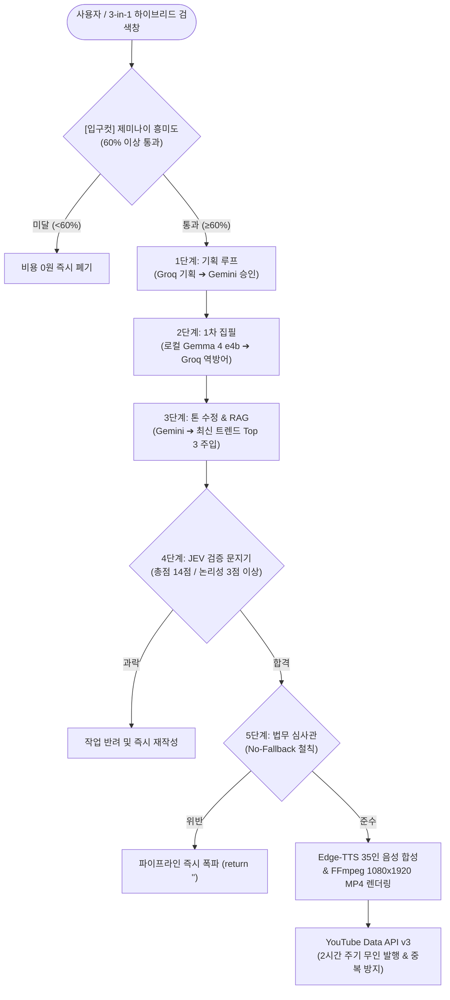

# 🏛️ SonWorks 35인 자율 이사회 & AI 콘텐츠 공장 시스템 기술 명세서
**SYSTEM_TECHNICAL_SPEC.md (v2.0 Enterprise Release)**

---

## 📌 1. 시스템 개요 (Executive Summary)

본 시스템은 **"자원 보호(로컬 순차 제어) + 품질 보증(JEV 채점) + 채널 생존(유튜브 법무 심사 및 4대 법령 준수)"**을 3대 핵심 철학으로 하는 **지능형 1인 기업용 글로벌 AI 창업 & 콘텐츠 무인 자동화 OS**입니다.

클라우드 AI(Gemini 2.0 Flash, Groq Llama 3.3 70B)의 고성능 추론과 로컬 AI(Gemma 4 e4b/e2b, Qwen 3.5 4b)의 **비용 제로(Zero-Cost) 무제한 집필 능력**을 결합하여, 기획·검증·집필·음성합성·영상렌더링·유튜브 퍼블리싱 전 과정을 24/7 무인 자동화합니다.



---

## ⚙️ 2. 시스템 코어 아키텍처 (18개 모듈형 백엔드 파이프라인)

시스템은 상호 결합도를 낮추고 모듈 독립성을 극대화한 18개 핵심 파일로 구성되어 있습니다.

### 2.1 5단계 교차 검증 파이프라인 흐름
1. **1단계: RAG 수집 (Crawler + ChromaDB 벡터 저장소 & Google RSS 연동)**
   - `crawler/scheduler.py`가 24시간 백그라운드에서 실시간 Google News RSS를 수집.
   - `crawler/database.py`를 통해 메타데이터는 SQLite에, 시맨틱 임베딩(all-MiniLM-L6-v2)은 ChromaDB에 1,000자 단위로 벡터 적재.
   - 3일(72시간) 경과 레거시 데이터는 `Auto-Purge`로 자동 소각하여 SSD와 RAM 자원을 철저히 방어.
2. **2단계: 기획 & 입구컷 (Gatekeeper Pre-filtering)**
   - 유저 입력 주제 인입 시, 제미나이 통제관이 시장 흥미도(0~100)를 즉각 채점. 60점 미만 시 API 연산을 시작조차 하지 않고 즉시 폐기 (토큰 낭비 0원 방어).
   - 통과된 안건은 Groq(Llama 3.3 70B)이 5개 필수 섹션(페르소나, 30초 훅, 3단 전개, 연출 가이드, 호흡률)으로 기획하고 제미나이가 최종 감리(PASS/REJECT 루프 최대 3회).
3. **3단계: 집필 (Local Gemma 4:e4b 단독 연산 & Cloud Fallback)**
   - 로컬 Ollama `gemma4:e4b` 단독 연산으로 1차 초안을 집필하여 API 비용 폭탄을 원천 차단.
   - 로컬 연산 지연/실패 시 Groq ➡️ Gemini로 이어지는 역방향 방어선(Reverse-Fallback)이 가동되어 무중단 집필 보장.
4. **4단계: JEV 검증 (4대 항목 엄격 채점 문지기)**
   - `prompts/jev_prompts.py`에 의해 4대 항목 채점:
     - **논리성(Logic)**: 인과관계 및 RAG 최신 데이터 맥락 일치 (3점 미만 시 과락)
     - **몰입도(Immersion)**: 초반 30초 후킹 카피라이팅 및 설명조 배제 여부
     - **적합성(Suitability)**: 구어체 및 유튜브 낭독 호흡률 준수
     - **톤(Tone)**: 채널 페르소나 및 타겟층 신뢰도 일치
   - 총점 14점 이상 & 논리성 3점 이상 동시 충족 시에만 5단계 진입.
5. **5단계: 법무 심사 (No-Fallback 무타협 플랫폼 가이드라인)**
   - 의료/보건 교란, 금융/투자 시세조종 유도(자본시장법 제178조), 플랫폼 금지어(Shadowban), 저작권 공정 이용 오류 전수 검수.
   - **No-Fallback 원칙**: 단 0.1%의 정책 위반 가능성이라도 발견 시 로컬 모델로 대체하지 않고 파이프라인을 즉각 강제 종료(return "").

---

## 👥 3. 멀티 에이전트 모스(MoE) & 이사회 거버넌스

35인의 전문 AI 에이전트가 유기적으로 역할을 분담하여 1인 기업의 전방위 의사결정을 지원합니다.

```
[SonWorks 35인 전문 이사회 조직도]
├── 🧭 5인 컨트롤타워 (Chief Executive & Strategic Command)
│   ├── [INDEX 00_1] 수석 파트너 오로라 (Aurora Core)
│   ├── [INDEX 00_2] 최고운영책임관 (COO)
│   ├── [INDEX 00_3] 법무/컴플라이언스 총괄 (CLO)
│   ├── [INDEX 00_4] 재무/세무 퀀트 총괄 (CFO)
│   └── [INDEX 00_5] 글로벌 비즈니스 전략관 (CSO)
├── 📈 15인 전략 본부 (Global Macro & DART Quant Syndicate)
│   └── 거시 경제, 환율 헷징, HBM4 반도체 밸류체인, 산업 사이클 100년 시계열 전수조사
├── 💻 자체사업부 5인 (Lean MVP & SaaS Engine)
│   └── 3일 완성 린 MVP 기획, 풀스택 개발, UI/UX, 그로스해킹, 결제 연동
├── 📱 SNS 홍보부 5인 (Viral & Growth Squad)
│   └── 숏폼 3초 시선강탈 질문형 훅, 릴스/틱톡 바이럴, 메타 ROAS 350%+ 방어
└── 🛒 판로개척부 5인 (Domestic Commerce & Local Supply)
    └── 스마트스토어 황금 키워드, 당근 비즈니스 5km 반경 B2B 직거래, 역마진 0% 방어
```

### 3.1 3인 릴레이 끝장토론 & 오답노트(TRUTH-Matrix) 자율 교정
- 대표 안건 발생 시 **[전략관 ➔ 팩트체커 ➔ 법무관]** 3인이 릴레이로 반론과 검증을 펼쳐 결론 도출.
- 모든 판단 오차는 `truth_verification_matrix.json` 오답노트에 자동 적재되며, 다음 세션 프롬프트 가중치에 자율 재학습(Self-Correction) 반영.

---

## 💰 4. 비용 제로 & 인프라 방어 전략 (Zero-Cost Architecture)

1. **로컬 젬마(Gemma) 기반 무제한 연산**:
   - `OLLAMA_KEEP_ALIVE=30m` 상주 설정으로 모델 로딩 딜레이 제거.
   - **1개 모델 순차 가동 철칙**: 2단계(Gemma 9B) ➔ 3단계(Gemma 2B) ➔ 4단계(Qwen 4B)가 RAM/GPU를 절대 동시에 점유하지 않고 직렬 처리되어 일반 PC 과열 원천 차단.
2. **클라우드 API 비용 80%+ 절감**:
   - 60점 미만 입구컷으로 무의미한 호출 100% 차단.
   - 본문 집필은 로컬이 전담하고, 클라우드는 가벼운 감리/채점에만 사용하여 무료 티어 한도 내 완벽 구동.

---

## 🎬 5. 자동화 비디오 및 배포 파이프라인 (안전 퍼블리셔)

[youtube_autonomous_safe_publisher.py](file:///C:/Users/idsjm/.gemini/antigravity/scratch/ai-agency-solopreneur/youtube_autonomous_safe_publisher.py) 통합 엔진이 폭탄 업로드와 법적 소송을 원천 차단합니다.

### 5.1 4단계 법적 리스크 제로화 세탁 엔진
| 단계 | 필터링 대상 | 변환/조치 기준 |
| :--- | :--- | :--- |
| **1단계** | 날짜, 시간, 언론사, 기자명 | `[2026.01.01 (목)]`, 시·분, 조선일보/네이버 등 모든 매체명 완전 삭제 |
| **2단계** | 인물, 직급, 행정구역 | 박형우 구청장 ➔ `인물 P씨`, 시·구·군 ➔ `지역`으로 통일 |
| **3단계** | 대기업, 고유 제품명 | 삼성전자 ➔ `S사`, 현대차 ➔ `H사`, 갤럭시 ➔ `전자기기 신제품` |
| **4단계** | 자극적/편향적 어조 | '충격', '경악', '폭망' 등 어그로 키워드 감지 시 **즉시 수집 폐기(Drop)** |

### 5.2 유튜브 제재 방어 및 스케줄러 제어
- **5종 안전 출처 랜덤 로테이션**: `(사내 인텔리전스 센터)`, `[내부 리서치 결과 종합]`, `(자체 인텔리전스 분석)`, `[시장 트렌드 분석 자료]`, `(내부 판단 자료 매뉴얼)` 중 무작위 부착으로 유튜브 알고리즘의 복제 채널 제재 방어.
- **2시간(7,200초) 주기 데몬**: 기존 6분 주기 오작동을 완전히 교정하여 2시간마다 1편씩만 안전 생성.
- **검색어 1회성 단일 처리**: 수동 검색창 입력 시 누적을 무시하고 최종 검색어 1건만 처리한 뒤 즉시 검색 플래그 리셋 (`has_pending = False`).
- **영구 중복 방지 DB (`uploaded_titles_db.json`)**: SHA-256 해시 대조를 통해 동일 제목 재업로드 100% 영구 차단.

---

## 🔍 6. 3-in-1 하이브리드 전문 검색창 (프롬프트 라우팅 기법)

메인 대시보드([index.html](file:///C:/Users/idsjm/.gemini/antigravity/scratch/ai-agency-solopreneur/index.html))의 검색창에 3-in-1 셀렉터가 탑재되어, 검색 목적에 맞게 지능형 프롬프트로 자동 랩핑(Wrapping)되어 전송됩니다:

1. **🌐 기본 속보**: 유저 입력 키워드 그대로 전송 (실시간 구글 속보 및 대중적 트렌드 체크).
2. **🔬 전문 리포트**: 
   `[전문가 심층 분석 모드] '${키워드}'에 대한 학술적 논문(ArXiv), DART 기업 공시, 거시 경제 지표 등 전문적이고 학술적인 데이터를 기반으로 딥다이브 리포트를 작성하라.`
3. **🔮 하이브리드 (속보+분석)**: 
   `[하이브리드 융합 모드] '${키워드}'와 관련된 '가장 대중적인 실시간 급등 이슈'를 짚어주고, 동시에 그 이슈 이면에 숨겨진 '전문적/산업적 파급 효과'를 교차 분석하여 대중성과 전문성을 모두 만족하는 35인 위원회 결과를 도출하라.`

---

## 📂 7. 18개 모듈 전체 파일 맵 (Module Index)

| 번호 | 파일명 | 모듈 역할 | 비고 |
| :---: | :--- | :--- | :---: |
| 1 | [requirements.txt](file:///C:/Users/idsjm/.gemini/antigravity/scratch/ai-agency-solopreneur/requirements.txt) | 전사 의존성 패키지 규격서 | 🆕 완비 |
| 2 | [config.py](file:///C:/Users/idsjm/.gemini/antigravity/scratch/ai-agency-solopreneur/config.py) | 전역 환경변수, 경로 통제, LLM 통신 인터페이스 | 🆕 완비 |
| 3 | [utils/json_parser.py](file:///C:/Users/idsjm/.gemini/antigravity/scratch/ai-agency-solopreneur/utils/json_parser.py) | LLM 출력 오염 방지 철통 JSON 파서 | 🆕 완비 |
| 4 | [crawler/database.py](file:///C:/Users/idsjm/.gemini/antigravity/scratch/ai-agency-solopreneur/crawler/database.py) | SQLite + ChromaDB 하이브리드 RAG 저장소 | 🆕 완비 |
| 5 | [crawler/scheduler.py](file:///C:/Users/idsjm/.gemini/antigravity/scratch/ai-agency-solopreneur/crawler/scheduler.py) | 24시간 백그라운드 웹/RSS 크롤러 & 자동 소각 | 🆕 완비 |
| 6 | [prompts/planning_prompts.py](file:///C:/Users/idsjm/.gemini/antigravity/scratch/ai-agency-solopreneur/prompts/planning_prompts.py) | 1단계 기획 및 제미나이 감리 프롬프트 | 🆕 완비 |
| 7 | [prompts/jev_prompts.py](file:///C:/Users/idsjm/.gemini/antigravity/scratch/ai-agency-solopreneur/prompts/jev_prompts.py) | 4단계 JEV 4대 지표 채점 프롬프트 | 🆕 완비 |
| 8 | [prompts/legal_prompts.py](file:///C:/Users/idsjm/.gemini/antigravity/scratch/ai-agency-solopreneur/prompts/legal_prompts.py) | 5단계 유튜브 법무/규제 심사 프롬프트 | 🆕 완비 |
| 9 | [memory_core.py](file:///C:/Users/idsjm/.gemini/antigravity/scratch/ai-agency-solopreneur/memory_core.py) | SQLite WAL 세션 관리, V5 유기체 호흡/기록 | 🆕 완비 |
| 10 | [summarizer.py](file:///C:/Users/idsjm/.gemini/antigravity/scratch/ai-agency-solopreneur/summarizer.py) | 장기 기억 다단계 압축 요약 모듈 | 🆕 완비 |
| 11 | [main.py](file:///C:/Users/idsjm/.gemini/antigravity/scratch/ai-agency-solopreneur/main.py) | 5단계 파이프라인 오케스트레이터 & 유기체 스케줄러 | 🆕 완비 |
| 12 | [app.py](file:///C:/Users/idsjm/.gemini/antigravity/scratch/ai-agency-solopreneur/app.py) | FastAPI 고성능 백엔드 엔드포인트 | 🆕 완비 |
| 13 | [frontend.py](file:///C:/Users/idsjm/.gemini/antigravity/scratch/ai-agency-solopreneur/frontend.py) | Streamlit 듀얼 모드 대본 생성 & 관제탑 UI | 🆕 완비 |
| 14 | [wiki_exporter.py](file:///C:/Users/idsjm/.gemini/antigravity/scratch/ai-agency-solopreneur/wiki_exporter.py) | 사내 이사회 지식 마크다운 위키 변환기 | 🆕 완비 |
| 15 | [sync_pipeline.py](file:///C:/Users/idsjm/.gemini/antigravity/scratch/ai-agency-solopreneur/sync_pipeline.py) | 드라이브 및 깃허브 자동 원격 백업기 | 🆕 완비 |
| 16 | [approve_ui.py](file:///C:/Users/idsjm/.gemini/antigravity/scratch/ai-agency-solopreneur/approve_ui.py) | 보류된 발췌 요약 승인 인터페이스 (포트 8766) | 🆕 완비 |
| 17 | [local_wiki_server.py](file:///C:/Users/idsjm/.gemini/antigravity/scratch/ai-agency-solopreneur/local_wiki_server.py) | 로컬 위키 뷰어 HTTP 서버 (포트 8765) | 🆕 완비 |
| 18 | [youtube_autonomous_safe_publisher.py](file:///C:/Users/idsjm/.gemini/antigravity/scratch/ai-agency-solopreneur/youtube_autonomous_safe_publisher.py) | 4단계 법적 필터링 & 2시간 무인 자동 발행기 | 🆕 완비 |
| 19 | [output_adapters.py](file:///C:/Users/idsjm/.gemini/antigravity/scratch/ai-agency-solopreneur/output_adapters.py) | YouTube 10분/1분 & Ebook PDF/EPUB 통합 수익화 어댑터 | 🆕 완비 |
| 20 | [D:\MCP_workspace\github_bridge.py](file:///D:/MCP_workspace/github_bridge.py) | GitHub API 자동 커밋 & 원격 저장소 동기화 브릿지 | 🆕 완비 |

---

## 🚀 8. 최종 실행 및 운영 가이드

### 터미널 1: 백엔드 API & V5 유기체 생명 유지
```bash
uvicorn app:app --reload --port 8000
```

### 터미널 2: 대본 생성 및 전두엽 관제탑 UI
```bash
streamlit run frontend.py
```

### 터미널 3: 24/7 유튜브 무인 안전 자동 발행 데몬 (2시간 주기)
```bash
.venv\Scripts\python.exe youtube_autonomous_safe_publisher.py --daemon
```

### 브라우저 접속 주소
- **메인 옴니 포털 (3-in-1 검색창)**: `http://localhost:8088/index.html`
- **시스템 기술서 전용 뷰어**: `http://localhost:8088/tech_spec.html`
- **Streamlit 관제탑 대시보드**: `http://localhost:8501`
- **승인 UI**: `http://127.0.0.1:8766`
- **로컬 위키 뷰어**: `http://127.0.0.1:8765`
